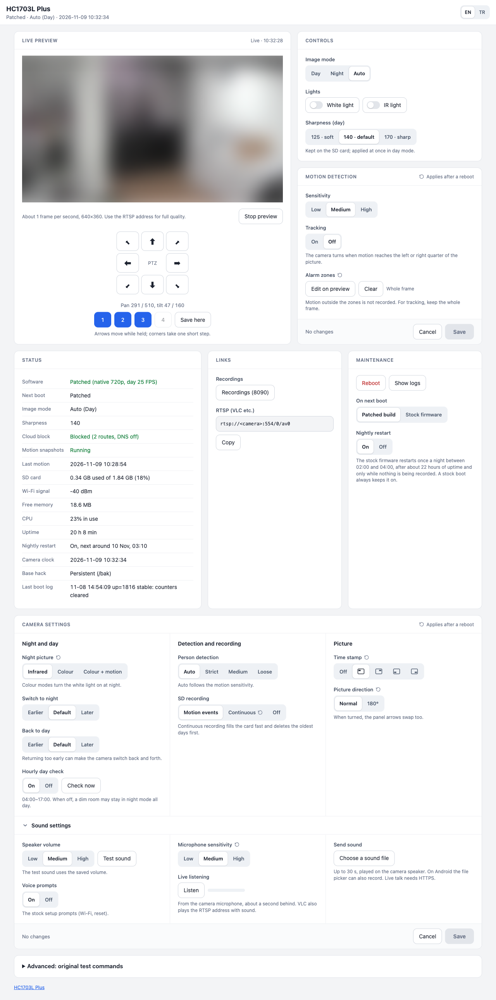

# HC1703L Plus

[Türkçe](README.tr.md)

A modern, privacy-first layer for the cheap Augentix **HC1703L** pan/tilt camera, built on top of
[Jalecom's hack](https://github.com/Jalecom/AJ_HC1703L_Teardown). The vendor program `p2pcam` stays in place as a closed "driver": it is
patched from **your own** copy of the firmware, and everything you interact with runs from the SD card.

> **Status:** in daily use on the author's camera since October 2026, firmware 57.0.8.0. Support for firmware
> 57.1.2.0 is new and not yet tested on a camera. Read [Compatibility](#compatibility) and [Recovery](#recovery)
> before you start.

<p align="center"><br>
<sub>The control panel. The camera picture is blurred for this screenshot.</sub></p>

## What you get

| | Stock | Plus |
|---|---|---|
| Resolution | 1920×1080, upscaled from a 1280×720 sensor | native 1280×720 |
| Frame rate | day 12.5, night 8 | day 25, night 12.5 |
| Video bitrate cap | 1 Mbps | 2.56 Mbps |
| Free RAM | ~14 MB | ~22 MB |
| Cloud | Tange/iCam365 SDK, HTTPDNS, reverse `teltun` tunnel | SDK never started, endpoints → loopback, tunnel command broken, all public IPs rejected |
| p2pcam services on the LAN | 80, 6670, 8001, 20202, CTP/HTTP over 554 | RTSP on 554 only |

Plus also adds:

- **Control panel** on `:8080`: live preview, press-and-hold PTZ, four saved camera positions, one-button
  white light and IR, day / night / auto (showing what is selected, not only what runs), sharpness presets, status (patched or stock, cloud block, Wi-Fi, SD, RAM, CPU, last motion), logs,
  and a switch for the stock firmware's nightly restart (see below).
  Commands are POST-only, so reloading the page or restoring a tab never re-runs a command. English and
  Turkish (EN/TR switch in the header; the gallery follows the panel's choice).
- **Recordings gallery** on `:8090`: motion events as cards (snapshot + clip), per-day view, in-browser
  playback, download, delete, select several events and delete them together, delete a whole day, a motion
  e-mail switch for an external mailer.
- **Motion settings** in the panel: sensitivity, tracking and up to 25 alarm zones drawn on the live
  preview. Sensitivity and tracking apply at once; zones after a reboot. Everything stays in RAM, so settings do
  not touch flash either.
- **Camera settings** in the panel: night picture (infrared or colour), when to switch to night and back to day,
  the hourly day check, person detection threshold, SD recording (motion events, continuous or off), time stamp
  corner and a 180° turn. Kept in `clean/cam.conf`; what `p2pcam` re-reads applies at once, the rest after a
  reboot. Nothing goes to flash.
- **Sound settings** (a section of the camera card that opens on click): speaker volume with a test sound, voice
  prompts on or off, microphone sensitivity, **live listening** in the browser (the camera's microphone, about a
  second behind) and **send a sound file** to the camera speaker (up to 30 s; on Android the file picker can also
  record). Live talk from the browser microphone needs HTTPS: browsers keep the microphone off on plain-HTTP pages.
- **Motion snapshots** (`mo.sh`): one snapshot per motion clip, linked to it.
- **Fixes:** RTSP socket buffer on the wrong socket, recordings skipping seconds in dim light, vendor
  port 554 accepting non-RTSP commands from the LAN.
- **Research:** how motion detection, zones and recording work inside `p2pcam`
  ([INTERNALS](docs/INTERNALS.md)).

## How it works

```
power on
 └─ stock start.sh
     ├─ <SD>/debug_cmd.sh   (Plus loader, deletes itself = one-shot)
     │    ├─ netguard.sh    cloud block (RAM copy)
     │    ├─ boot.sh        waits for the SD card, then runs health.sh
     │    ├─ binds RAM copies of clean/p2pcam.sqfs and clean/sensor.sh over /bak   (flash untouched)
     │    ├─ applies clean/md.conf + cam.conf to RAM copies of devParam.dat and hwcfg.ini   (flash untouched)
     │    └─ keeps devParam/extraParam/osdParam and their _bak copies in RAM, so vendor saves stay off flash
     ├─ sensor.sh → minihack.sh (base hack: Wi-Fi, telnet, FTP, httpd)
     └─ p2pcam (patched)
health.sh  T+0 plus.sh (panel, gallery, motion service, clock re-sync every 6 h, stops the factory test loop)
           T+5 min  healthy → put the loader back; 3 failed boots in a row → stays stock
           T+30 min still healthy → clear the failure counters
```

Plus never writes to flash. The stock PTZ driver still does: it saves the camera position to `/home/psp.dat`
after a move, and after every tracking return. Removing the SD card, or deleting `debug_cmd.sh` from it, gives you the plain
base hack on the next boot. A reboot from the panel does not count as a failed boot, so several setting changes
in a row do not drop the camera to stock.

## Compatibility

- Two `p2pcam` builds (sensor SC1346). `build.sh` refuses anything else: patch offsets differ between builds and
  a wrong patch can boot-loop the camera.

  | Firmware (app) | `p2pcam` sha256 | Patched md5 | Status |
  |---|---|---|---|
  | 57.0.8.0 | `5e2dc1a15734e214…` | `718a2a38ad4a52c5618157c0995b2fd1` | in daily use |
  | 57.1.2.0 | `146e7faff2f2dfd0…` | `fda4668a44d61380aadbd4a47327fa05` | ported from a user's dump, not yet tested on a camera |
- Requires the base hack's **permanent** version (`HACKTYPE=P`, `/home/minihack.sh`) for Wi-Fi without the
  cloud, telnet, FTP and the BusyBox httpd.
- Build host: Linux or macOS with `python3` and `squashfs-tools` (`unsquashfs`, `mksquashfs`, xz).

## Install

1. Install the base hack's permanent version as described in [Jalecom's README](https://github.com/Jalecom/AJ_HC1703L_Teardown).
   Check that telnet, FTP and `http://<camera>:8080` work.
2. Copy `/bak/p2pcam.sqfs` from the camera to your computer (FTP).
3. Build: `patcher/build.sh p2pcam.sqfs out/`. The patched `p2pcam` md5 must match your firmware's line in
   [Compatibility](#compatibility).
4. Copy to the SD card root: `sdcard/clean/`, `sdcard/motion/`, `sdcard/mo.sh`.
   Put `out/p2pcam.sqfs`, `out/p2pcam.sqfs.md5` and `out/p2pcam.md5` into `clean/`.
   **Do not copy `debug_cmd.sh` yet.**
5. Boot the camera, then over telnet: `sh /tmp/mnt/mmc01/0/clean/prepare.sh`
   It builds `sensor.sh` and `sensor_day.ini` from your camera's own files (no vendor files are shipped).
6. Arm the loader: `cp /tmp/mnt/mmc01/0/clean/debug_cmd.sh /tmp/mnt/mmc01/0/; sync; reboot`
7. After about a minute the panel's status should read **Patched**, and the RTSP stream
   (`rtsp://<camera>:554/0/av0`) should be 1280×720.

## Nightly restart

The stock `p2pcam` itself restarts the camera once a night; neither the base hack nor Plus causes it. It does this at a random time
between 02:00 and 04:00 (camera clock), and only after about 22 hours of uptime and when nothing is being recorded.
It is on by default. **Off** in the panel's Maintenance card writes `clean/NOREBOOT`; the setting is applied at
once and again on every patched boot. A stock boot always keeps the restart on, so a camera that fell back to stock
gets the patched build back the next night. Nothing is written to flash.

The base hack sets the clock once at boot. So that the clock does not drift with the restart off, `clock.sh`
re-syncs it every 6 hours from the default gateway (the router), the only time server the cloud block leaves.

## Recovery

- **Back to stock for one boot:** delete `debug_cmd.sh` from the SD card root. The next healthy boot
  re-arms it.
- **Disable Plus:** `touch <SD>/clean/DISABLE` and delete `debug_cmd.sh` from the root.
- **Camera unreachable or rebooting in a loop:** power off, put the SD card in a computer, delete
  `debug_cmd.sh` from the card root, put it back, power on. Why it can happen: the base hack's line in
  `/bak/sensor.sh` skips `minihack.sh` while `debug_cmd.sh` exists, and `minihack.sh` is what brings Wi-Fi
  up. If the loader cannot run or delete itself, there is no Wi-Fi and the camera reboots in a loop
  (observed once; most likely `p2pcam`'s own reboot when the Wi-Fi interface stays down). If a Mac shows
  the card as read-only, check the lock switch on the SD adapter.

## Security notes

- Keep the camera on a private network and never expose it to the internet.
- RTSP has no password (stock behaviour) and includes audio.
- Telnet (no password) and FTP (`root` / `cxlinux`) come from the base hack: anyone on your LAN can
  control the camera.
- The panel and gallery have no login, by design, for a private network.
- The base hack ships one shared dropbear host key. If you enable SSH, generate your own key.

## Known limitations

- Two firmware builds only. Other builds need new offsets.
- Tested on one camera (57.0.8.0).
- A zone change needs a reboot. Zones written to the running `p2pcam` were not picked up.
- With tracking on, all motion is recorded, but the camera only turns for motion inside a zone, once that motion
  reaches the left or right quarter of the frame. For tracking, keep the whole frame selected.
- Tracking does not follow someone in the middle half of the frame, so a person walking straight at the camera
  is not followed. Tilt moves only together with a pan, in large steps.
- Every 10th return, and 30 minutes after a return, the camera sweeps for about 20 s to find its reference and
  goes to the saved position. If it lands somewhere else the first time, turn tracking off, aim it with the panel
  arrows, and turn tracking on again.
- No HTTPS (BusyBox httpd), so the panel cannot use the browser microphone for two-way audio.

## Credits and license

- [@Jalecom](https://github.com/Jalecom) for the [base hack and teardown](https://github.com/Jalecom/AJ_HC1703L_Teardown), which this project
  builds on and requires, and the contributors listed there.
- mp4box.js 0.5.2 by GPAC (BSD 3-Clause) is included for in-browser playback.
- `sdcard/clean/bin/mdcfg`, `ptzpos` and `snd` are static ARM builds of `tools/mdcfg.c`, `tools/ptzpos.c` and
  `tools/snd.c` (build command in the source).
- This repository contains only HC1703L Plus code, MIT licensed ([LICENSE](LICENSE)). The base hack is
  not included; get it from its own repository.
- Not affiliated with Augentix or Tange. No vendor binaries are distributed. Use at your own risk.

## Optional: run the health check on every boot

Without this, the health check only runs on boots where the loader was armed. To also run it after a
fallback boot, add this to the end of `/home/minihack.sh` (a flash write; keep a copy of the original):

```sh
( n=0; until grep -q ' /tmp/mnt/mmc01/0 ' /proc/mounts || [ $n -ge 90 ]; do sleep 2; n=$((n+1)); done
  [ -f /tmp/mnt/mmc01/0/clean/health.sh ] && cp /tmp/mnt/mmc01/0/clean/health.sh /tmp/health.sh && sh /tmp/health.sh ) </dev/null >/dev/null 2>&1 &
```
