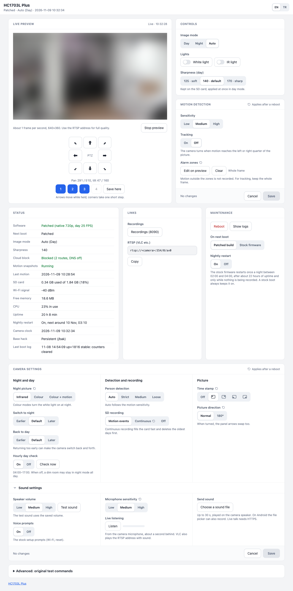

# HC1703L Plus

[English](README.md)

Ucuz Augentix **HC1703L** pan/tilt kamera için, [Jalecom'un hack'i](https://github.com/Jalecom/AJ_HC1703L_Teardown) üzerine kurulan,
gizliliği öne alan modern bir katman. Üreticinin `p2pcam` programı kapalı bir "sürücü" olarak yerinde
kalır: **kendi** kameranızdan aldığınız kopya üzerinden yamalanır, kullandığınız her şey SD karttan çalışır.

> **Durum:** Ekim 2026'dan beri yazarın kamerasında, firmware 57.0.8.0 ile her gün kullanılıyor. Firmware 57.1.2.0
> desteği yeni ve henüz bir kamerada denenmedi. Başlamadan önce [Uyumluluk](#uyumluluk) ve [Kurtarma](#kurtarma)
> bölümlerini okuyun.

<p align="center"><br>
<sub>Kontrol paneli. Kamera görüntüsü bu ekran görüntüsü için bulanıklaştırıldı.</sub></p>

## Ne kazanırsınız

| | Stok | Plus |
|---|---|---|
| Çözünürlük | 1920×1080, 1280×720 sensörden büyütülmüş | gerçek 1280×720 |
| Kare hızı | gündüz 12,5, gece 8 | gündüz 25, gece 12,5 |
| Video bit hızı tavanı | 1 Mbps | 2,56 Mbps |
| Hareket klibinin başlangıcı | olaydan 1–4 sn önce | olaydan yaklaşık 10 sn önce |
| Boş RAM | ~14 MB | ~19 MB (3 MB'ı daha uzun ön kayda gidiyor) |
| Bulut | Tange/iCam365 SDK, HTTPDNS, ters `teltun` tüneli | SDK hiç başlamaz, uç noktalar loopback'e, tünel komutu bozuk, tüm genel IP'ler reddedilir |
| p2pcam'in LAN'a açık servisleri | 80, 6670, 8001, 20202, 554 üzerinden CTP/HTTP | yalnız 554'te RTSP |

Ayrıca:

- **Kontrol paneli** (`:8080`): canlı önizleme, basılı tutunca dönen PTZ, dört kayıtlı kamera konumu, tek
  düğmeyle beyaz ışık ve IR, gündüz / gece / otomatik (yalnız çalışan modu değil seçimi de gösterir), keskinlik
  hazır ayarları, durum (yamalı mı stok mu, bulut engeli, WiFi, SD,
  RAM, CPU, son hareket), günlükler ve stok yazılımın gece yeniden başlatması için bir anahtar (aşağıya bakın).
  Komutlar yalnız POST ile gider: sayfayı yenilemek ya da geri yüklenen
  sekme komutu tekrar çalıştırmaz. İngilizce ve Türkçe (başlıktaki EN/TR anahtarı; galeri
  panelin seçimini izler).
- **Kayıt galerisi** (`:8090`): hareket olayları kart olarak (fotoğraf + klip), gün görünümü, tarayıcıda
  oynatma, indirme, silme, birden çok olayı seçip birlikte silme, bir günü toplu silme, harici bir mail betiği
  için hareket maili anahtarı.
- **Hareket ayarları** panelde: hassasiyet, takip ve canlı önizleme üzerinde çizilen en çok 25 alarm
  bölgesi. Hassasiyet ve takip hemen, bölgeler yeniden başlatınca uygulanır. Her şey RAM'de kalır, ayarlar da
  flash'a dokunmaz.
- **Kamera ayarları** panelde: gece görüntüsü (kızılötesi ya da renkli), geceye geçiş ve gündüze dönüş
  zamanı, saat başı gündüz denemesi, kişi algılama eşiği, SD kayıt (hareket olayları, sürekli ya da kapalı),
  saat damgasının köşesi ve 180° çevirme. `clean/cam.conf` içinde saklanır; `p2pcam`'in yeniden okuduğu
  ayarlar hemen, diğerleri yeniden başlatınca uygulanır. Flash'a hiçbir şey yazılmaz.
- **Ses ayarları** (kamera kartında tıklayınca açılan bölüm): test sesli hoparlör düzeyi, sesli uyarıları açıp
  kapama, mikrofon hassasiyeti, tarayıcıda **canlı dinleme** (kameranın mikrofonu, yaklaşık bir saniye gecikmeli)
  ve kameranın hoparlörüne **ses dosyası gönderme** (en çok 30 sn; Android'de dosya seçici kayıt da yapabilir).
  Tarayıcı mikrofonuyla canlı konuşma HTTPS ister: tarayıcılar düz HTTP sayfalarında mikrofonu kapalı tutar.
- **Hareket fotoğrafları** (`mo.sh`): her hareket klibi için bir fotoğraf, klibe bağlı.
- **Düzeltmeler:** RTSP soket arabelleğinin yanlış sokete verilmesi, loş ışıkta kayıtların saniye
  atlaması, 554 portunun LAN'dan RTSP dışı komut kabul etmesi.
- **Araştırma:** hareket algılama, bölgeler ve kaydın `p2pcam` içinde nasıl çalıştığı
  ([İÇ YAPI](docs/IC-YAPI.md)).

## Nasıl çalışır

```
güç verilir
 └─ stok start.sh
     ├─ <SD>/debug_cmd.sh   (Plus yükleyicisi, kendini siler = tek seferlik)
     │    ├─ netguard.sh    bulut engeli (RAM kopyası)
     │    ├─ boot.sh        SD kartı bekler, sonra health.sh'yi çalıştırır
     │    ├─ clean/p2pcam.sqfs ve clean/sensor.sh'nin RAM kopyalarını /bak üzerine bağlar   (flash'a dokunmaz)
     │    ├─ clean/md.conf ve cam.conf'u devParam.dat ve hwcfg.ini'nin RAM kopyalarına uygular   (flash'a dokunmaz)
     │    └─ devParam/extraParam/osdParam ve _bak kopyalarını RAM'de tutar: üreticinin kayıtları flash'a gitmez
     ├─ sensor.sh → minihack.sh (temel hack: WiFi, telnet, FTP, httpd)
     └─ p2pcam (yamalı)
health.sh  T+0 plus.sh (panel, galeri, hareket servisi, 6 saatte bir saat eşitleme, fabrika test döngüsünü durdurur)
           T+5 dk  sağlıklıysa yükleyiciyi geri koyar; art arda 3 başarısız açılış → stokta kalır
           T+30 dk hâlâ sağlıklıysa başarısızlık sayaçlarını siler
```

Plus flash'a hiç yazmaz. Stok PTZ sürücüsü ise yazar: hareketten sonra ve her takip dönüşünde kamera konumunu
`/home/psp.dat` dosyasına kaydeder. SD kartı çıkarmak ya da içinden `debug_cmd.sh`'yi silmek, bir sonraki açılışta
sizi düz temel hack'e döndürür. Panelden yapılan yeniden başlatma başarısız açılış sayılmaz; art arda ayar
değiştirmek kamerayı stoğa düşürmez.

## Uyumluluk

- İki `p2pcam` sürümü (SC1346 sensör). `build.sh` başka sürümü reddeder: yama adresleri sürümden sürüme
  değişir ve yanlış yama kamerayı yeniden başlama döngüsüne sokabilir.

  | Firmware (uygulama) | `p2pcam` sha256 | Yamalı md5 | Durum |
  |---|---|---|---|
  | 57.0.8.0 | `5e2dc1a15734e214…` | `172468cf2bc865fb614e6ab55f8369b1` | her gün kullanılıyor |
  | 57.1.2.0 | `146e7faff2f2dfd0…` | `0f93e2034ed5376f0c342c134895d1d2` | bir kullanıcının dökümünden uyarlandı, henüz kamerada denenmedi |
- Temel hack'in **kalıcı** sürümü gerekir (`HACKTYPE=P`, `/home/minihack.sh`): buluta gerek kalmadan
  WiFi, telnet, FTP ve BusyBox httpd ondan gelir.
- Derleme bilgisayarı: `python3` ve `squashfs-tools` (`unsquashfs`, `mksquashfs`, xz) olan Linux ya da macOS.

## Kurulum

1. Temel hack'in kalıcı sürümünü [Jalecom'un README'sindeki](https://github.com/Jalecom/AJ_HC1703L_Teardown) gibi kurun. Telnet, FTP ve
   `http://<kamera>:8080` çalışıyor mu kontrol edin.
2. Kameradan `/bak/p2pcam.sqfs` dosyasını bilgisayarınıza alın (FTP).
3. Derleyin: `patcher/build.sh p2pcam.sqfs out/`. Yamalı `p2pcam` md5 değeri, [Uyumluluk](#uyumluluk)
   bölümünde sizin firmware sürümünüzün satırındakiyle aynı olmalı.
4. SD kartın köküne kopyalayın: `sdcard/clean/`, `sdcard/motion/`, `sdcard/mo.sh`.
   `out/p2pcam.sqfs`, `out/p2pcam.sqfs.md5` ve `out/p2pcam.md5` dosyalarını `clean/` içine koyun.
   **`debug_cmd.sh`'yi henüz kopyalamayın.**
5. Kamerayı açın, telnet ile: `sh /tmp/mnt/mmc01/0/clean/prepare.sh`
   Bu betik `sensor.sh` ve `sensor_day.ini` dosyalarını kameranızın kendi dosyalarından üretir;
   üreticiye ait hiçbir dosya dağıtılmaz.
6. Yükleyiciyi kurun: `cp /tmp/mnt/mmc01/0/clean/debug_cmd.sh /tmp/mnt/mmc01/0/; sync; reboot`
7. Yaklaşık bir dakika sonra paneldeki durum **Yamalı** göstermeli, RTSP akışı
   (`rtsp://<kamera>:554/0/av0`) 1280×720 olmalı.

## Gece yeniden başlatma

Kamerayı her gece bir kez stok `p2pcam`'in kendisi yeniden başlatır; bunun sebebi ne temel hack ne de Plus'tır. Bunu 02:00 ile 04:00 arasında
rastgele bir saatte (kamera saatiyle) yapar. Kameranın yaklaşık 22 saattir açık olması ve o sırada kayıt
yapılmıyor olması gerekir. Varsayılan olarak açıktır. Paneldeki Bakım kartında **Kapalı** seçilince
`clean/NOREBOOT` yazılır. Ayar hemen ve her yamalı açılışta yeniden uygulanır. Stok açılışta yeniden başlatma hep
açık kalır; böylece stoğa düşen bir kamera ertesi gece yamalı sürüme geri döner. Flash'a hiçbir şey yazılmaz.

Temel hack saati açılışta bir kez ayarlar. Yeniden başlatma kapalıyken saat kaymasın diye `clock.sh` saati 6 saatte
bir varsayılan ağ geçidinden (router) eşitler; bulut engeli açıkken ulaşılabilen tek zaman sunucusu odur.

## Kurtarma

- **Bir açılışlığına stoğa dönmek:** SD kart kökünden `debug_cmd.sh`'yi silin. Bir sonraki sağlıklı
  açılış onu geri koyar.
- **Plus'ı kapatmak:** `touch <SD>/clean/DISABLE` ve kökteki `debug_cmd.sh`'yi silin.
- **Kameraya ulaşılamıyor ya da sürekli yeniden başlıyor:** gücü kesin, SD kartı bilgisayara takın,
  kart kökündeki `debug_cmd.sh`'yi silin, geri takın, gücü verin. Neden olabilir: temel hack'in
  `/bak/sensor.sh` içine eklediği satır, `debug_cmd.sh` dururken `minihack.sh`'yi atlar; WiFi'yi açan da
  `minihack.sh`'dir. Yükleyici çalışamaz ya da kendini silemezse WiFi gelmez ve kamera döngüye girer
  (bir kez gözlendi; büyük olasılıkla `p2pcam`'in WiFi arayüzü kapalı kalınca yaptığı yeniden başlatma).
  Mac kartı salt okunur gösterirse SD adaptörünün yanındaki kilit anahtarına bakın.

## Güvenlik notları

- Kamerayı özel bir ağda tutun, asla internete açmayın.
- RTSP parolasızdır (stok davranış) ve ses de içerir.
- Telnet (parolasız) ve FTP (`root` / `cxlinux`) temel hack'ten gelir: yerel ağınızdaki herkes kamerayı
  yönetebilir.
- Panel ve galeri özel ağ için bilerek girişsizdir.
- Temel hack herkese aynı dropbear sunucu anahtarını dağıtır. SSH açarsanız kendi anahtarınızı üretin.

## Bilinen sınırlar

- Yalnız iki firmware sürümü. Diğer sürümler için yeni adresler gerekir.
- Tek kamerada denendi (57.0.8.0).
- Bölge değişikliği için yeniden başlatma gerekir. Çalışan `p2pcam`'e yazılan bölgeler okunmadı.
- Takip açıkken bütün hareket kaydedilir, ama kamera yalnız bölge içindeki hareket görüntünün sol ya da sağ
  çeyreğine ulaşınca döner. Takip için bütün kareyi seçili bırakın.
- Takip, görüntünün orta yarısındaki kişiyi izlemez; kameraya tam önden yaklaşan kişi izlenmez. Dikey hareket
  yalnız yatay dönüşle birlikte ve büyük adımlarla olur.
- Her 10. dönüşte ve bir dönüşten 30 dakika sonra kamera, referansını bulmak için yaklaşık 20 sn tarama yapar ve
  kayıtlı konuma gider. İlk seferde başka yere düşerse takibi kapatın, panel oklarıyla ayarlayın, takibi yeniden
  açın.
- HTTPS yok (BusyBox httpd), bu yüzden panel çift yönlü ses için tarayıcı mikrofonunu kullanamaz.

## Teşekkür ve lisans

- Bu projenin üzerine kurulduğu ve ihtiyaç duyduğu [temel hack ve söküm](https://github.com/Jalecom/AJ_HC1703L_Teardown) için
  [@Jalecom](https://github.com/Jalecom) ve orada adı geçen katkıcılar.
- Tarayıcıda oynatma için GPAC'ın mp4box.js 0.5.2 kütüphanesi (BSD 3-Clause) pakete dahildir.
- `sdcard/clean/bin/mdcfg`, `ptzpos` ve `snd`; `tools/mdcfg.c`, `tools/ptzpos.c` ve `tools/snd.c`'nin statik ARM
  derlemeleridir (derleme komutu kaynakta).
- Bu depoda yalnız HC1703L Plus kodu vardır, MIT lisanslıdır ([LICENSE](LICENSE)). Temel hack pakete
  dahil değildir; kendi deposundan alınır.
- Augentix ya da Tange ile bağlantısı yoktur. Üreticiye ait ikili dağıtılmaz. Kullanım sorumluluğu
  size aittir.

## İsteğe bağlı: sağlık denetimini her açılışta çalıştırmak

Bu olmadan sağlık denetimi yalnız yükleyicinin kurulu olduğu açılışlarda çalışır. Stoğa düşülen
açılışlardan sonra da çalışması için `/home/minihack.sh` dosyasının sonuna şunu ekleyin
(flash yazımıdır, orijinalin kopyasını saklayın):

```sh
( n=0; until grep -q ' /tmp/mnt/mmc01/0 ' /proc/mounts || [ $n -ge 90 ]; do sleep 2; n=$((n+1)); done
  [ -f /tmp/mnt/mmc01/0/clean/health.sh ] && cp /tmp/mnt/mmc01/0/clean/health.sh /tmp/health.sh && sh /tmp/health.sh ) </dev/null >/dev/null 2>&1 &
```
